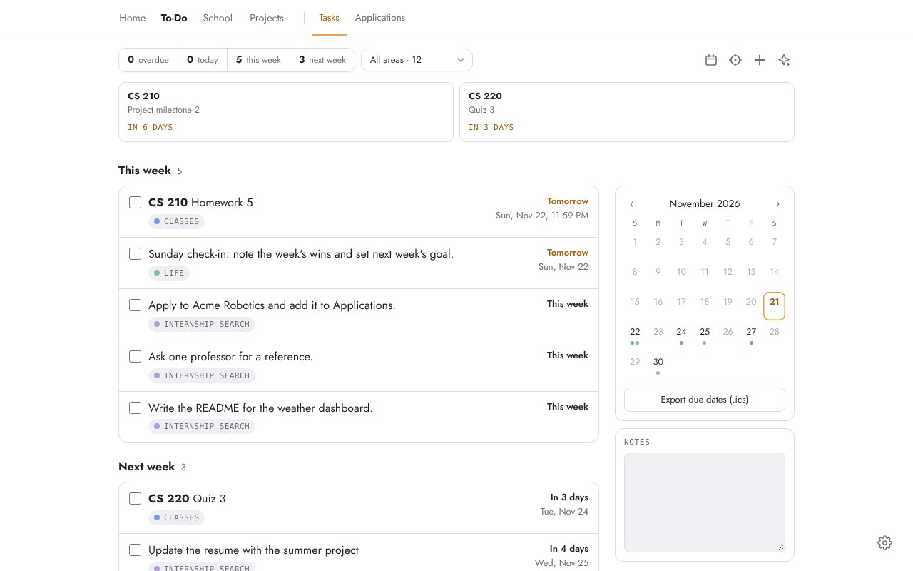
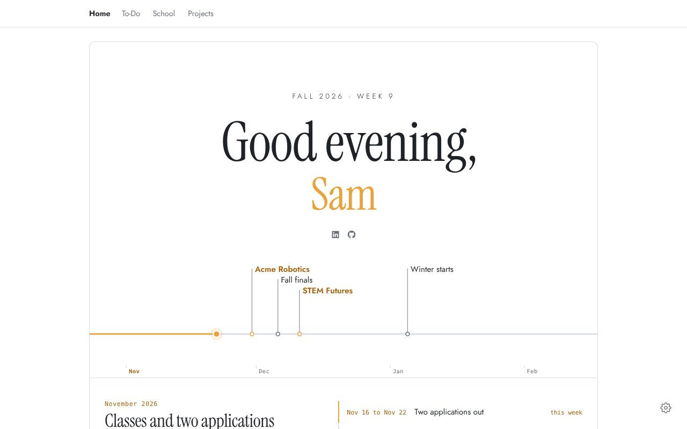
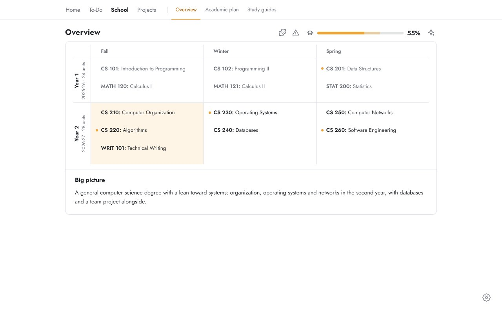

# roadmap

A personal roadmap site for a student: one to-do list for classes, applications and projects, a year-by-year academic plan with graduation requirements, and pages for projects, a portfolio and certifications. Plain HTML, CSS and JavaScript with no build step. It is filled in and kept current by talking to Claude, using the skills in `skills/`.

| Home | School overview |
|---|---|
|  |  |

The pictures show the made-up student in `content/sample.js`.

## What is in it

- **Home**: a greeting, the school year as a timeline, and four small summaries (tasks, applications, school, projects). It is the only page a visitor who is not signed in can see.
- **To-Do**: tasks grouped by when they are due, a month and week calendar, repeating tasks, notes, and assignments pulled from a Canvas calendar feed. **Applications** sits beside it as a board of stages.
- **School**: an overview of every term, the academic plan with a course map, graduation requirements checked against the plan, and study guides listed by class.
- **Projects**: what is in progress and planned, and which target skills each project covers. **Portfolio** and **Certifications** follow the same layout.
- **Settings**: day and night themes, five accent colors, backup, and the Canvas link.

## Set up a copy

1. **Copy the repo.** Fork it or use it as a template, then clone it.
2. **Fill in the content.** Add the `career-roadmap-builder` skill to Claude (the text is in `skills/career-roadmap-builder/SKILL.md`) and ask it to set the site up. It asks for a name, school, degree and major, quarter or semester system, and a degree audit, then writes `content/content.js` following `content/SETUP.md`. The file can also be written by hand: `content/README.md` describes every section.
3. **Look at it.** `sh scripts/preview.sh` serves the site at http://localhost:8000. `python3 scripts/check.py` checks the content. To see the site filled in before writing anything, copy the made-up student over: `cp content/sample.js content/content.js` (`python3 scripts/sample.py` rewrites the sample around today's date, and `--semester` makes it a semester school).
4. **Put it online.** Import the repo into Vercel (no build settings needed) and write the site's address into `config.js`. Any static host works, but the Canvas feed needs the small function in `api/`, which runs on Vercel.
5. **Optional: save across devices.** Create a Supabase project, run `supabase/setup.sql` once in its SQL editor, create one account under Authentication, and put the project's address and publishable key in `config.js`. Sign in from the gear on the site. The database keeps data for that first account only, so nobody else can sign up and take the site over. The first sign-in moves the content into the database, and from then on Claude changes it there with no deploy. Without Supabase, checkmarks and settings stay in the browser and the content stays in `content/content.js`.

## Claude skills

Each skill is one `SKILL.md` under `skills/`. Signed in, a page that has a skill shows an icon at the right end of its top bar that opens the skill's text with a copy button.

| Skill | Page | What it does |
|---|---|---|
| `career-roadmap-builder` | School | Sets the site up for a new person and updates the plan when it changes. |
| `roadmap-checkin` | To-Do | A short check-in: what got done, what is new, then updates the list. |
| `roadmap-project-planner` | Projects, Portfolio | Recommends projects and builds one out. |
| `roadmap-certification-planner` | Certifications | Recommends certifications and fills in the page. |
| `interactive-exam-study-guide` | Study guides | Builds a study guide for an exam and saves it to the site. |

## License

MIT. See `LICENSE`.
